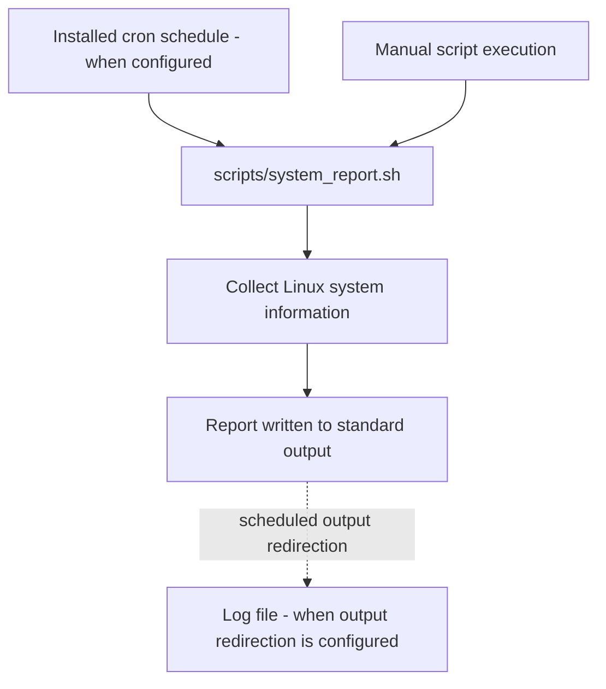
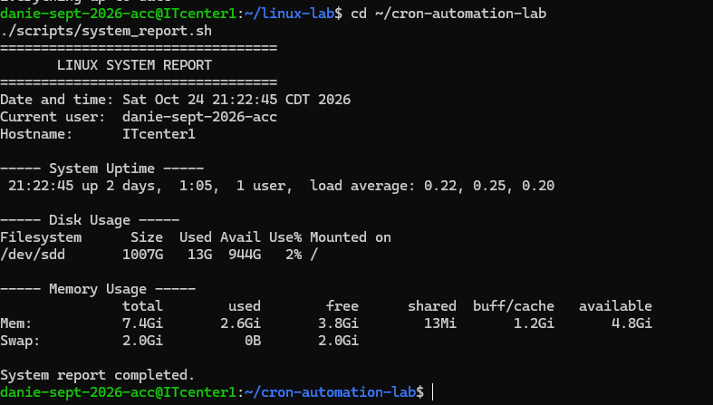

# Linux Cron Automation Lab

## Project Overview

This project demonstrates Linux job scheduling with Cron and
system administration automation using Bash.

It is part of my hands-on learning portfolio for Linux administration,
AWS Cloud System Administration, and DevOps.

## Technology Stack

- Ubuntu Linux
- Bash
- Cron
- Linux command-line utilities
- Git and GitHub

## Project Files

- `scripts/system_report.sh` — collects basic system information
- `cron/example-crontab` — example daily scheduling entry
- `logs/` — local output logs, excluded from Git
- `README.md` — project documentation
- `.gitignore` — excludes generated and sensitive files

## Run the Script Manually

Make it executable:

    chmod +x scripts/system_report.sh

Run it:

    ./scripts/system_report.sh

## Schedule the Script

Review `cron/example-crontab` before installing it.

Replace `YOUR_USERNAME` with the actual Linux username and confirm
the absolute paths. Create the log directory if necessary.

Use `crontab -e` to edit your personal crontab and add the verified
schedule line. Use `crontab -l` to inspect installed jobs.

The example file does not install or activate a cron job by itself.

## Logging

The example schedule redirects standard output and errors into
`logs/system-report.log`. This provides a basic audit trail for
troubleshooting scheduled automation.

## Skills Demonstrated

- Bash scripting and executable permissions
- Linux system information commands
- Cron scheduling syntax
- Output redirection and logging
- Documentation and version control

## Security

- Do not put passwords, tokens, AWS keys, or private keys in scripts.
- Review scheduled commands before installing them.
- Keep credentials and personal configuration outside the repository.

## Future Improvements

- Add disk-space threshold alerts
- Add log rotation
- Check service status automatically
- Add error handling and exit-code reporting
- Run script checks through Jenkins

## Automation Workflow Diagram

This diagram illustrates the intended scheduled workflow. The committed crontab file is an example and is not automatically installed on the system.

## Screenshot Evidence

This screenshot shows an actual run of the system-report script. The diagram describes the intended scheduled workflow; it does not claim that the example cron entry is currently active.
